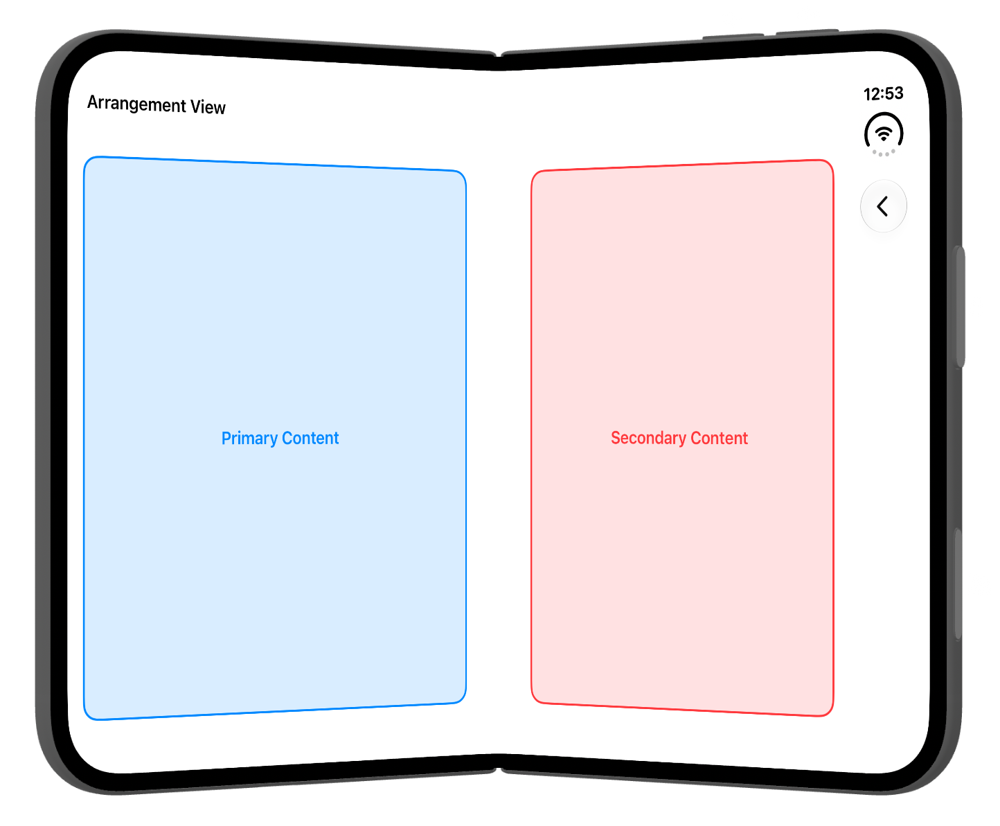

# iPhone Duo Sample

A UIKit sample app demonstrating APIs introduced for iPhone Duo in iOS 27.1, including hinge updates, reserved regions, and `UIArrangementViewController`.

## Requirements

- Xcode 27.1 or later

The app runs on other supported iPhones and iPads, but iPhone Duo-specific APIs are reported as unavailable.

## Xcode Canvas 预览

使用 Xcode 27.1 或更新版本打开 `iPhoneDuoSample.xcodeproj`，选择 `iPhoneDuoSample` scheme，并打开下列源码文件。通过 **Editor > Canvas** 显示画布，点击 **Resume / Refresh Canvas** 启动预览，再切换具名场景。

| 源码入口（位于 `iPhoneDuoSample/Features/`） | 预览场景 |
| --- | --- |
| `Intro/IntroViewController.swift` | 首页：竖屏、横屏、Regular 宽屏横向布局、深色、辅助功能大字体、RTL |
| `Arrangement/ArrangementViewController.swift` | Arrangement：竖屏、横屏、Regular 宽屏横向布局、深色、辅助功能大字体、RTL |
| `Reserved Regions/ReservedRegionViewController.swift` | Reserved Regions：竖屏、横屏、Regular 宽屏横向布局、深色、辅助功能大字体、RTL |
| `Arrangement/Views/ArrangementContentViewController.swift` | Primary、Secondary 内容组件 |
| `Reserved Regions/Views/ReservedRegionLegendView.swift` | Active、Inactive 区域图例 |

共 22 个 `#Preview` 入口。三个页面均保留导航容器，后两个页面使用与应用一致的导航标题。首页按钮在独立预览中不会跳转；请分别打开目标页面预览，或运行应用验证导航。

`Core/Views/PreviewSupport.swift` 集中配置预览实例的 UIKit traits。Regular 场景使用 1024 × 768 pt 画布和 Regular size classes；大字体场景使用 `accessibilityExtraExtraExtraLarge`；RTL 仅调整预览实例的布局方向，不翻译应用文案。组件沿用现有 ViewModel 的颜色和文字。预览声明和支持代码均由 `#if DEBUG` 隔离，Release 不包含这些入口。

### 系统数据与验证边界

- 查看铰链和保留区域时，在 Canvas 中选择安装了 iOS 27.1 或更新 runtime 的 iPhone Duo。`UIHingeInteraction`、`reservedRegions` 和 `UIArrangementViewController` 仍然读取预览宿主的真实系统环境；固定画布尺寸和 Regular traits 不会模拟折叠姿态。
- 其他设备、较旧 runtime 或未提供铰链回调的 Canvas 宿主，遵循现有页面逻辑。首页文案依赖铰链状态回调，回调尚未到达时可能只显示按钮；保留区域也可能为空。预览不会注入固定角度或伪造区域。
- Canvas 通过正常控制器生命周期触发布局，不手动调用 `viewDidInitialize()`。布局检查包括横竖屏、宽屏、深色、大字体和 RTL；预览中发现的既有裁切或适配问题应单独记录。
- Debug / Release 构建成功只证明编译通过。Canvas 实际渲染、设备系统数据以及折叠交互需要分别验证。

## Demo

<video src="iphone-duo.mp4" controls>
  Your browser does not support embedded video.
</video>

[Demo video](iphone-duo.mp4).

## License

This project is available under the MIT License. See [LICENSE](LICENSE) for details.
